# SolidCraft Wood

**SolidCraft Wood** is a parametric woodworking and cabinet-making module for [SolidCraft](../../README.md). It adds a dedicated **Wood** ribbon workspace for bounding-box cabinet layout, parametric panel generation, edgebanding, decor & grain direction tracking, CNC & hardware joinery, cup hinges, drawer systems, assembly joints, and automated cutting list + STEP/CSV export — with optional `F5` DLL hot-reload support during development.

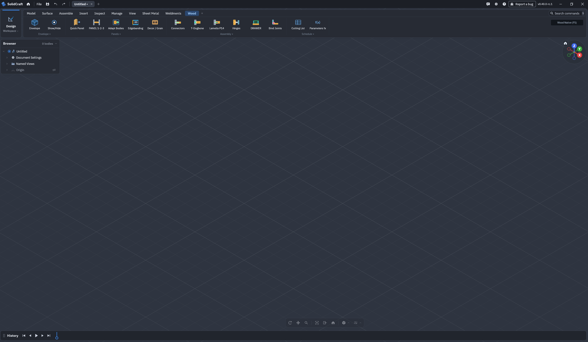

---

## Workflow & Tools

### 1. Envelope (`Cabinet Envelope` & `Show/Hide`)
Define the overall cabinet bounding volume (`Width (X)`, `Depth (Y)`, `Height (Z)`, `Board Thickness`, and `Opacity`) to establish parametric cabinet dimensions (`Szerokosc`, `Glebokosc`, `Wysokosc`, `Grubosc`). Use **Show/Hide** to toggle the bounding box visibility while picking interior panel faces.

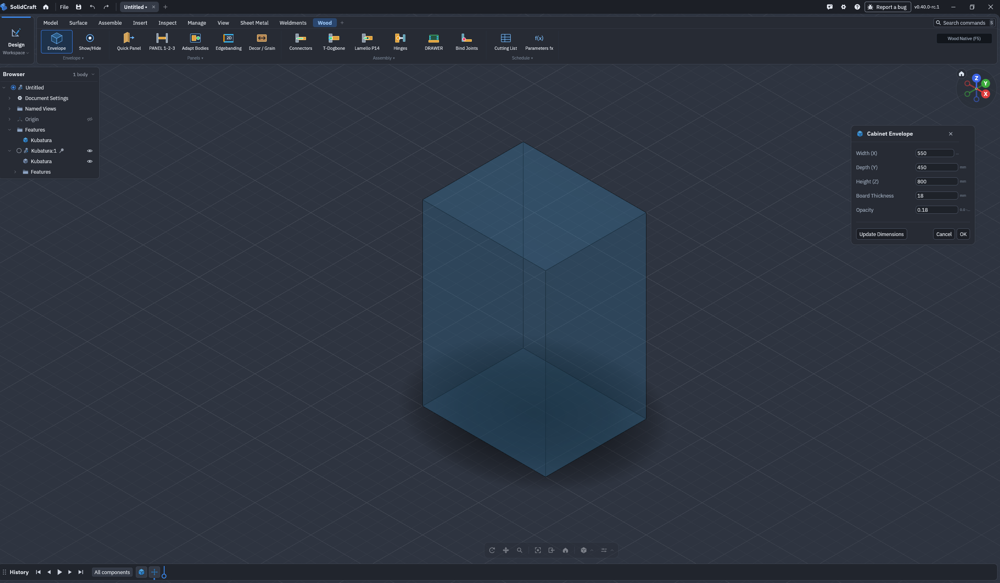

### 2. Quick Panel
Select a face on the cabinet envelope (or an existing panel) to generate a panel inside or outside the bounding volume with live 3D preview and configurable offsets/margins.

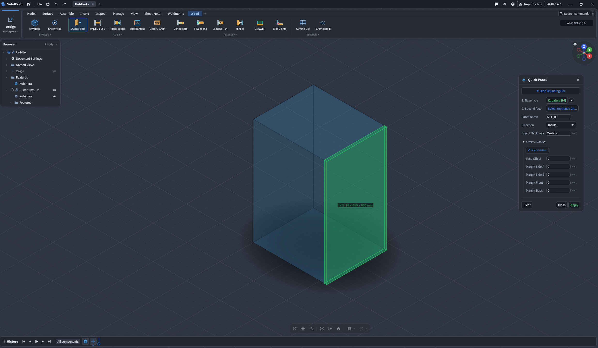

### 3. PANEL 1-2-3 (`Free Panel`)
Create shelves, dividers, rails, and stretchers between two opposing side faces (`1. Two sides`), bounded by either two front/back faces or a face + width (`2. Front / Back`), and positioned relative to an attach face (`3. Attach face`).

````carousel
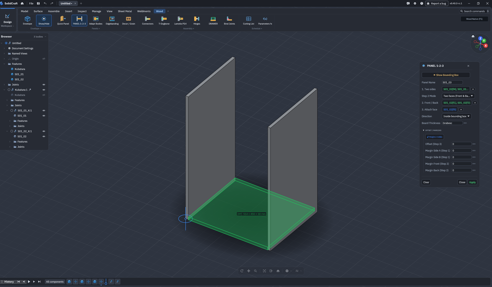
<!-- slide -->
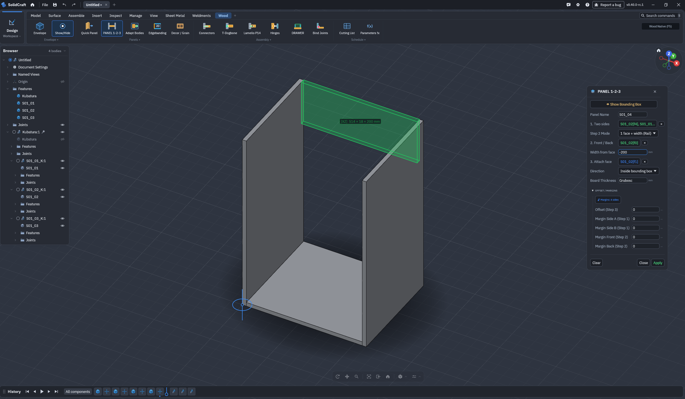
````

### 4. Adapt Bodies
Scan the document tree for loose or imported solid bodies outside panel components and adopt them into the cabinet as parametric wood panels (`S01_XX`).

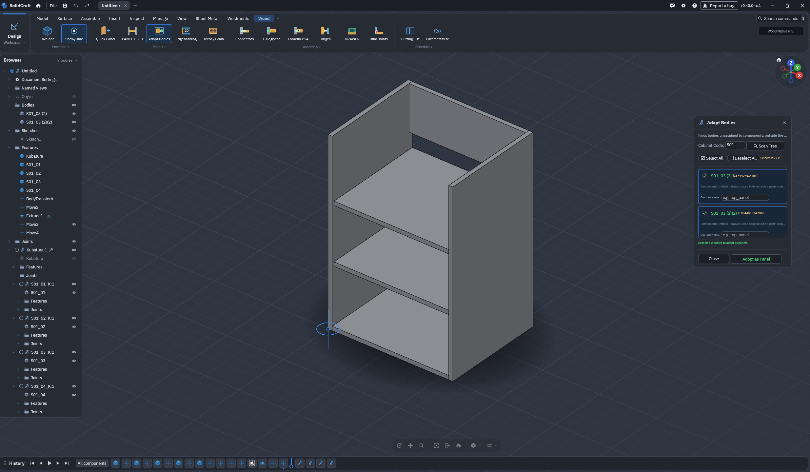
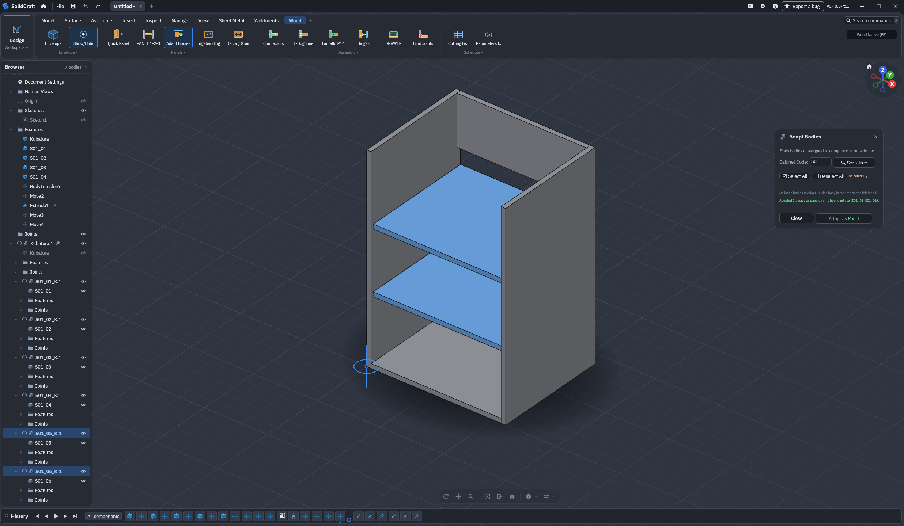

### 5. Edgebanding
Assign edgebanding profiles (ABS/PVC, Paper, etc.) to narrow panel edges in **Manual** or **Automatic** mode, with live 3D edge highlighting and edge-length tracking for the cutting list (`1D2K`, `2D0K`, etc.).

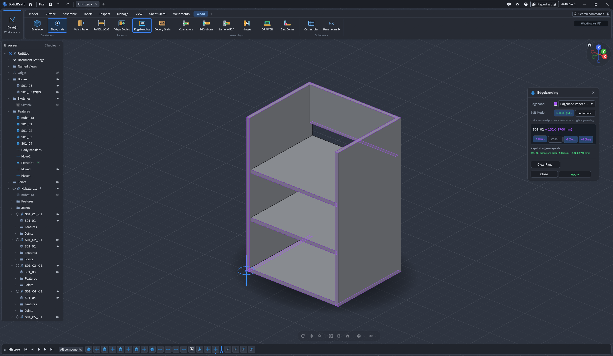

### 6. Decor & Grain
Assign board decors from the catalog (or add custom decors saved to `decors.json`) and toggle grain orientation (`0° Along` / `90° Across`) with live 3D grain direction arrows rendered on each panel.

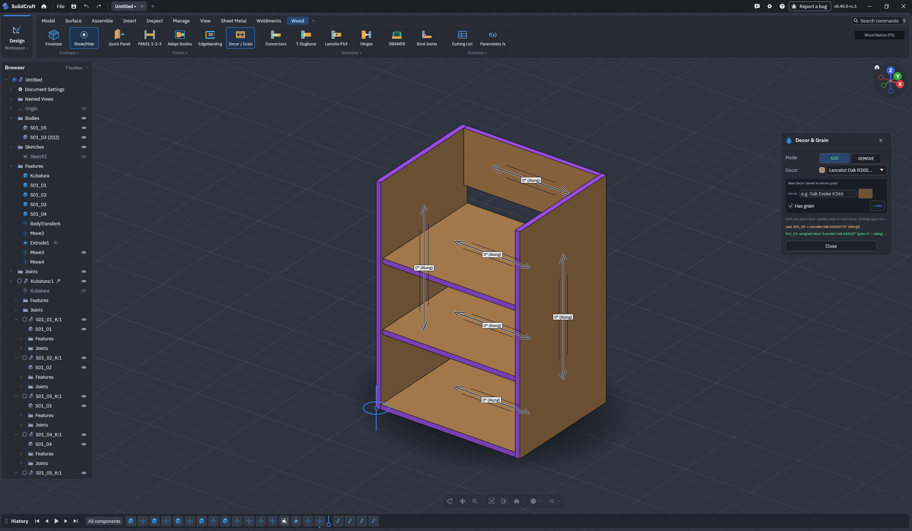

### 7. Connectors (`Dowels / Cam Locks / Confirmats`)
Pick a panel edge (`1. Edge`) and a perpendicular mating face (`2. Face`) to place parametric drilling operations for wooden dowels, cam locks, or confirmats with live 3D preview.

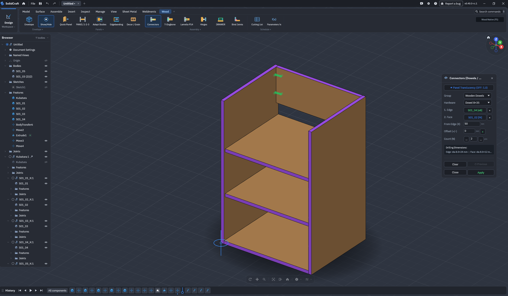

### 8. T-Dogbone Joint (CNC)
Generate CNC mortise-and-tenon joints with configurable width, end offsets, count, and automatic dogbone corner reliefs + HSM relief pockets.

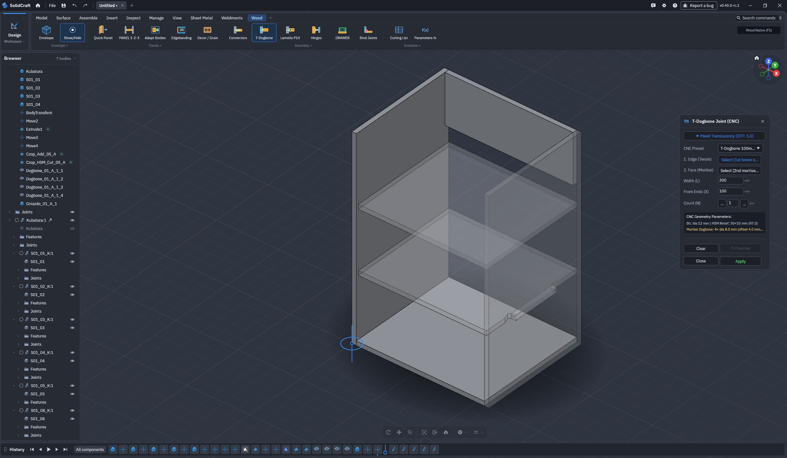

### 9. Lamello P14
Place **Lamello P14** / Clamex-style biscuit/connector slots along panel joints (available directly from the **Assembly** ribbon group).

### 10. Cup Hinges (`Hinges`)
Pick the back face of a door (`1. Front Back`) and the mating cabinet side (`2. Side Panel`) to place cup hinge and mounting-plate drillings (`Blum / GTV / Häfele`, etc.) with live 3D cup and plate previews.

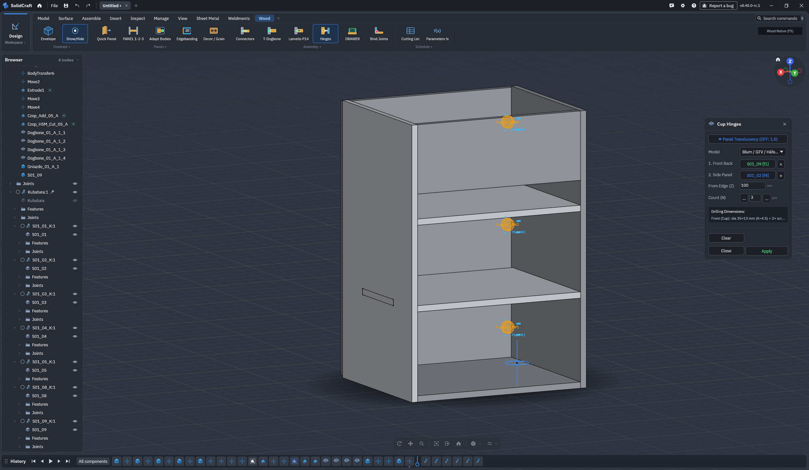

### 11. DRAWER (`Drawer Systems`)
Pick `1. Left side`, `2. Right side`, `3. Bottom panel`, and `4. Front back-face` to fit a parametric drawer box (`Sevroll V-BOX`, `Blum`, etc.) with live 3D box preview, clearance check, and slide + front/back drilling generation.

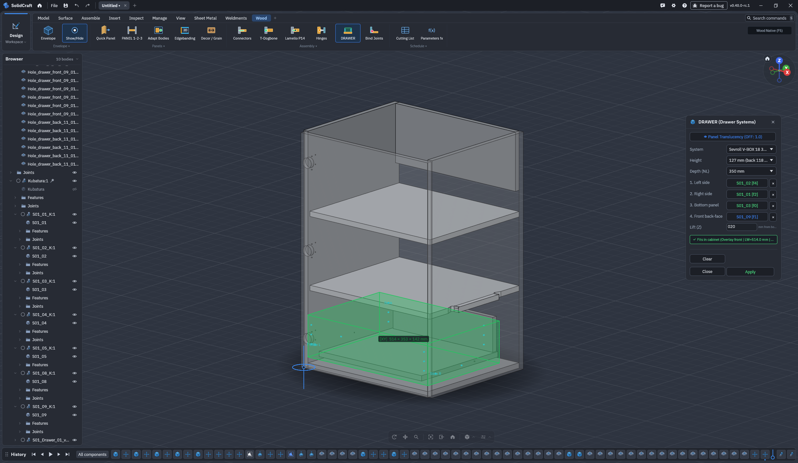

### 12. Bind Joints (`Assembly & Joints`)
Lock panel components into rigid or articulated assembly joints relative to the cabinet coordinate frame.

### 13. Cutting List & Export (`Schedule`)
Review all panels in a live schedule with cabinet codes, custom descriptions, dimensions (`Length × Width × Thickness`), edgeband codes, decor names, and grain orientation. Apply standardized panel names to the model, copy CSV to clipboard, or export **STEP + CSV** files to the target folder.

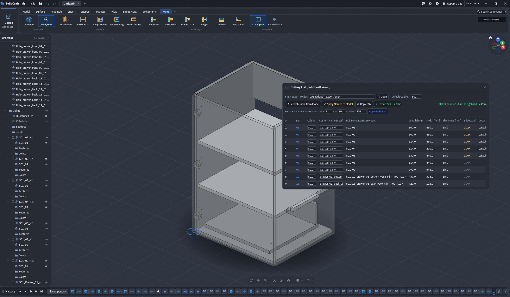

### 14. Parameters (`Parameters fx`)
Inspect and edit cabinet-level parametric variables directly from the **Schedule** group.

---

## Hardware & Decor Configuration

Hardware presets and decors are loaded from JSON files under `crates/wood/assets/hardware/` (and runtime config):
- `connectors.json` — dowel, cam lock, confirmat, and Lamello presets
- `hinges.json` — cup hinge cup/plate geometry presets
- `drawers.json` — drawer system profiles, slide clearances, and hole patterns
- `edgebands.json` — edgeband material/thickness definitions
- `decors.json` — board decor colors and grain defaults
- `tdogbone.json` — CNC T-dogbone tool diameter and relief presets

---

## Building, Hot-Reload & Tests

### Run Unit Tests
```bash
cargo test -p wood --lib
```

### Hot-Reload Development (`dynamic-wood`)
SolidCraft supports hot-reloading the `wood` crate as a dynamic library (`wood.dll` / `libwood.so`) using **F5** while the app is running:

```bash
# Build the dynamic wood plugin
cargo build -p wood --features dynamic-wood

# Launch SolidCraft (wood_host loads target/debug/wood.dll)
cargo run -p solidcraft
```

After editing code inside `crates/wood`, rebuild `cargo build -p wood --features dynamic-wood` and press **F5** in SolidCraft to reload the module without restarting the application.
